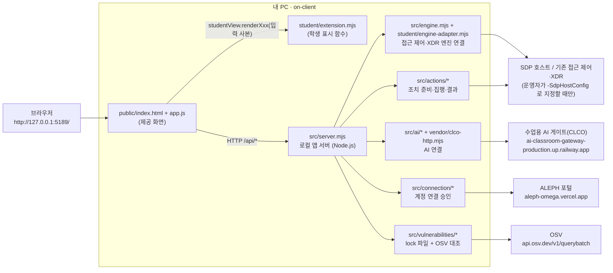

# 케셰브 실행 설명서와 시스템 구성도 (학생 작성)

이 문서는 다른 사람이 이 저장소를 받아 **케셰브** 앱을 켜고, 끄고, 다시 켜고, 오류를 구분할 수 있도록 학생이 작성했습니다. 제공 문서(`on-client/README.md`, `docs/STUDENT_LAUNCH_GUIDE.md`, `docs/CONNECTION_TROUBLESHOOT.md` 등)를 덮어쓰지 않았고, 이 문서의 명령·경로·주소는 이 저장소의 `package.json`, `.env.example`, `tools/start-alekov.ps1`, `src/server.mjs`, `public/app.js` 와 대조해 적었습니다.

표기 규칙: **확인함** = 내 PC 화면에서 직접 확인, **모의 점검** = 모의 입력으로 함수 출력만 점검, **코드 대조** = 코드를 읽고 맞춘 것, **미확인** = 실행·확인하지 않음.

## 1. 필요한 프로그램과 버전

| 항목 | 요구 | 근거 | 내 확인 상태 |
|---|---|---|---|
| Windows + PowerShell | 실행 도구가 PowerShell 스크립트 | `tools/start-alekov.ps1` | 확인함(워크벤치 PC에서 실행) |
| Node.js | 22~24, 검수 기준 24.19.0 | `package.json` `engines.node: 24.19.0`, 실행 도구의 버전 검사 | 실행은 됐으나 정확한 버전 번호는 **미확인** |
| npm 패키지 | 없음(외부 의존성 0, lock 파일 없음) | `package.json` 에 `dependencies` 없음 | 코드 대조 |
| 브라우저 | PC 브라우저 | `http://127.0.0.1:5189/` | 확인함 |
| Git | 커밋·제출용 | 저장소 최상위 = 프로젝트 폴더 | 확인함 |

`npm install`은 필요 없습니다(설치할 의존성이 없습니다).

## 2. 폴더 구조

```text
Keshev/                         ← Git 저장소 최상위(프로젝트 폴더)
├─ README.md                    ← 학생 작성: 목적·기능·구성·환경
├─ .gitignore                   ← 학생 작성: .env·node_modules 등 제외
└─ on-client/                   ← 앱 폴더(여기서 PowerShell을 엽니다)
   ├─ package.json              ← 제공: start / demo / check 스크립트
   ├─ .env.example              ← 제공: 비밀 없는 환경변수 예시
   ├─ README.md, docs/*         ← 제공 문서 (docs/STUDENT_RUNBOOK.md 만 학생 작성)
   ├─ public/                   ← 제공 화면: index.html, app.js, style.css, ai-connect.mjs, vulnerabilities-view.mjs
   ├─ student/
   │  ├─ extension.mjs          ← 학생 작성: 화면 표시 함수 8개
   │  └─ engine-adapter.mjs     ← 제공: SDP 호스트 연결 어댑터
   ├─ src/                      ← 제공 서버: server.mjs, engine*, ai/, connection/, actions/, vulnerabilities/, learner-support/
   ├─ tools/                    ← 제공 실행 도구: start-alekov.ps1 등
   └─ vendor/                   ← 제공: clco-http.mjs (AI 게이트 HTTP)
```

## 3. 실행하기

1. 파일 탐색기에서 `on-client` 폴더를 엽니다(바로가기·링크가 아닌 실제 폴더).
2. 주소 표시줄에 `powershell` 을 입력하고 Enter → 그 폴더에서 PowerShell 창이 열립니다.
3. 아래를 실행합니다.

```powershell
powershell -NoProfile -ExecutionPolicy Bypass -File .\tools\start-alekov.ps1
```

4. **정상 시작 신호** (실행 도구가 출력하는 두 줄, 앞에 서버 로그 `케셰브 연결 확인: http://127.0.0.1:5189` 가 함께 보일 수 있음):
   - `케셰브가 켜졌습니다. 브라우저에서 http://127.0.0.1:5189/ 을 여세요.`
   - `서버가 응답한 것만 확인했습니다. AI 연결 상태는 화면에서 따로 확인해 주세요.`
5. 브라우저에서 `http://127.0.0.1:5189/` 를 엽니다. 위쪽 상태 표시와 「보호 현황」 화면이 보이면 정상입니다.

같은 서버를 켜는 다른 방법(`package.json` 스크립트, 앱 폴더에서):

| 명령 | 하는 일 | 주의 |
|---|---|---|
| `npm start` | `node src/server.mjs` | Node 버전·포트를 미리 검사하지 않음 |
| `npm run demo` | `node src/server.mjs --demo` 예제 자료 | 실제 연결·성취가 아님 |
| `npm run check` | `node --check student/extension.mjs` | 문법만 확인 |

실행 도구 옵션(`tools/start-alekov.ps1` 의 `param`): `-Port <1024~65535>`(기본 5189), `-Demo`, `-Background`, `-NativeHostConfig "<경로>"`, `-NoNativeHost`, `-SdpHostConfig "<경로>"`, `-WaitSeconds <1~120>`(기본 20).

## 4. 종료와 다시 실행

| 할 일 | 방법 |
|---|---|
| 종료 | 앱을 켠 PowerShell 창에서 `Ctrl+C`. 브라우저 주소가 더 이상 열리지 않으면 종료됨 |
| `-Background` 로 켰을 때 종료 | 창에 안내된 프로세스 번호의 node 를 작업 관리자에서 종료 |
| 다시 실행 | 같은 `on-client` 폴더에서 3장의 명령을 다시 실행. 실행·종료는 내 파일을 바꾸지 않음 |
| 학생 코드 수정 후 반영 | 서버를 종료 → 다시 실행 → 브라우저 새로고침 |

## 5. 시스템 구성도

### 5-1. Mermaid



### 5-2. 글로 쓴 구성(그림과 같은 내용)

```text
[브라우저] ──▶ [제공 화면 public/app.js] ──(입력 사본)──▶ [학생 함수 student/extension.mjs] ──▶ DOM 요소 반환
                     │
                     └─ HTTP /api/* ─▶ [로컬 앱 서버 src/server.mjs]
                                           ├─ /api/me, /api/apps, /api/events, /api/devices, /api/sessions, POST /api/access
                                           │      └─▶ 엔진(src/engine.mjs) ─▶ 기본: disconnected / -Demo: 예제 / -SdpHostConfig: SDP 호스트
                                           ├─ POST /api/ai/check, POST /api/ai/explain ─▶ 수업용 AI 게이트(CLCO)
                                           ├─ /api/native-login/* ─▶ ALEPH 포털 계정 승인
                                           ├─ POST /api/actions/prepare | execute | result ─▶ 조치 처리(연동 시스템)
                                           ├─ GET /api/vulnerabilities ─▶ package-lock 대조 + OSV(허용 목록이 있을 때만)
                                           └─ GET /api/diagnostics ─▶ 비밀 없는 도움정보
```

### 5-3. 구성 요소 표

| 구성 요소 | 파일 | 외부 연결 | 기본 상태 |
|---|---|---|---|
| 화면 | `public/index.html`, `public/app.js` | 없음 | 항상 |
| 학생 표시 | `student/extension.mjs` | 없음(요청을 보내지 않음, DOM만 반환) | 항상 |
| 로컬 서버 | `src/server.mjs` | 127.0.0.1 에서만 수신, cross-site 요청 거부(`ORIGIN_REJECTED`) | 포트 `ON_PORT` 기본 5189 |
| 접근 제어·XDR 엔진 | `src/engine.mjs`, `student/engine-adapter.mjs` | SDP 호스트 | 설정 없으면 `disconnected`(`ENGINE_NOT_CONNECTED`) |
| AI 연결 | `src/ai/*`, `vendor/clco-http.mjs` | 수업용 AI 게이트 | 승인 전에는 미연결·권한 준비 중 |
| 계정 연결 | `src/connection/*` | ALEPH 포털 | 화면에서 확인 번호 승인 필요 |
| 조치 처리 | `src/actions/*` | 연동 시스템 | 지원 조치가 없으면 준비 버튼 없음(정상) |
| 취약점 조회 | `src/vulnerabilities/*` | OSV | `ON_APPROVED_PUBLIC_PACKAGES=[]` 이면 외부 조회 안 함(not_checked/not_configured) |

비밀값(키·토큰·인증서)은 구성도·문서·저장소 어디에도 없습니다. 계정 연결 설정과 자격 보관소는 실행 도구가 프로젝트 밖 Windows 사용자 폴더에 둡니다.

## 6. 제공 코드와 학생 코드의 경계

제공 화면(`public/app.js`)이 요청·검증·취소·늦은 응답 버리기(세대 번호)를 맡고, 검증한 결과의 **사본**만 학생 함수에 넘깁니다. 학생 함수는 요청을 보내지 않고 `createElement`/`textContent` 로 만든 DOM 요소만 반환합니다. 학생 함수가 예외를 던지면 제공 화면이 그 칸에만 오류를 표시하고 나머지 화면은 계속 동작합니다.

| 단계 | 학생 함수 | 입력(제공 화면이 전달) | 학생이 구현한 핵심 | 확인 상태 |
|---|---|---|---|---|
| 13 | `renderIdentity` | `{ me, devices, sessions }` | 로그인·기기·세션 상태, 로딩·오류·확인 불가 구분 | 포털 판정 통과 |
| 14 | `renderDecision` | `{ status, mode, data, error, appId }` | allow/deny/challenge/unknown, 요청 실패를 거부로 쓰지 않음 | 포털 판정 통과 |
| 15 | `renderEvents` | `{ status, mode, data, error }` | 최신순 사본 정렬, 필터, 상세(근거·규칙·상태), 미지원 조치는 비활성 | 포털 판정 통과 |
| 16 | `renderStatus` | `{ devices, sessions, notifications, diagnostics, mode }` | 알림·도움정보, 비밀값 패턴 제거 후 복사 | 포털 판정 통과 |
| 17 | `renderAiConnection` | `{ status, mode, data, error, checkedAt, explanationAccepted }` | idle/loading/ok/error, test·verified, 오류 원인별 안내, 수동 재점검 | 포털 판정 통과, 모의 점검 |
| 18 | `renderExplanation` | `{ event, explanation, checkedAt }` | 근거 ID 대조, 규칙·확인 불가 상태, 근거 불일치·executed:true 거부 | 포털 판정 통과, 모의 점검 |
| 19 | `renderAction` | `{ status, event, actionId, target, receipt, observation, message, confirmationExpiresAt, error }` | 제안·사람 확인·ACK·효과 관측 구분, 현재 사건 대조, 버튼 없음 | 포털 판정 통과, 모의 점검 |
| 20 | `renderVulnerabilities` | `{ status, mode, data, error }` | 정확한 설치 버전만 인정, 미조회·일부 실패 구분, 받은 ID 보존 | 포털 판정 통과, 모의 점검 |

포털 판정은 서버 AI가 커밋 코드를 읽고 내린 판정이며, 코드를 실행한 결과가 아닙니다.

## 7. 오류가 났을 때 확인 순서

### 7-1. 실행 도구(PowerShell 창) — `tools/start-alekov.ps1` 의 실제 메시지

| 메시지 | 원인 | 확인·복구 |
|---|---|---|
| `Node.js 가 없습니다` / `지금 Node.js 는 vXX` | Node 없음·지원 밖 버전 | Node.js 22~24(기준 24.19.0) 설치 → PowerShell 창을 새로 열고 다시 실행 |
| `포트 5189 를 다른 프로그램이 쓰고 있습니다` | 포트 충돌 | 그 프로그램은 두고 `-Port 5190` 으로 실행, 브라우저도 `:5190` |
| `앱 폴더가 아닙니다` / `시작 틀 폴더가 아닙니다` | `on-client` 밖에서 실행, 또는 `package.json` 의 `name` 이 다름 | `on-client` 실제 폴더에서 실행 |
| `계정 연결 준비 도구가 빠졌습니다` | `tools/prepare-native-host.ps1` 없음 | 기존 작업을 보존한 채 담당자에게 시작 틀 갱신 요청 |
| `앱 서버가 N 초 안에 뜨지 않았습니다` | 서버가 제한 시간 안에 응답하지 않음 | 창 메시지 전체를 강사에게 전달, 필요하면 `-WaitSeconds 30` |

### 7-2. 화면(앱 안) — `public/app.js`·학생 함수가 표시하는 상태

| 화면 표시 / 코드 | 뜻 | 확인 순서 | 성공인가 |
|---|---|---|---|
| 연결 없음(disconnected), `ENGINE_NOT_CONNECTED` | 엔진 설정 없이 켬(기본) | 운영자가 SDP 설정을 안내했는지 확인 → 안내된 경우만 `-SdpHostConfig` | 아니오 |
| 예제(demo) | `-Demo`/`npm run demo` | 실제 결과가 필요하면 옵션 없이 다시 실행 | 아니오 |
| `CONTRACT_MISMATCH`, `ENGINE_RESULT_UNVERIFIED`, 확인 불가 | 응답 형식을 믿을 수 없음 | 「다시 불러오기」를 직접 누름 → 반복되면 도움정보 전달 | 아니오(빈 결과로도 보지 않음) |
| `TIMEOUT`, `ENGINE_TIMEOUT`, `NETWORK_ERROR` | 시간 초과·서버 연결 실패 | 서버 창이 켜져 있는지 확인 → 잠시 뒤 직접 다시 시도 | 아니오 |
| `ON_AI_PROVISIONING_PENDING`, `AI_REQUEST_UNVERIFIED` | AI 권한 준비 중·확인 불가(운영자 준비) | 계정 연결·AI 승인 순서 확인 → 담당자에게 앱 권한 확인 요청 | 아니오(학생 잘못으로 단정 안 함) |
| `WB_CLCO_AUTH_REQUIRED`, `WB_CLCO_ACCESS_BLOCKED` | 인증 실패·접근 제한 | 계정 연결·AI 승인 다시 확인 → 담당자 확인. 열쇠를 복사해 붙이지 않음 | 아니오 |
| `WB_CLCO_COHORT_BUDGET_EXHAUSTED`, `WB_CLCO_LIMIT_REACHED` | 반 사용량·한도 | 담당자 확인 | 아니오 |
| `WB_CLCO_SESSION_CLOSED` | AI 이용 시간 아님 | 이용 시간 확인 후 직접 재점검 | 아니오 |
| `WB_CLCO_RATE_LIMITED`, `WB_CLCO_TIMEOUT` | 요청 제한·시간 초과 | 잠시 뒤 「현재 API 연결 점검」 직접 누름 | 아니오 |
| `CANCELLED` | 사용자가 취소 | 이전 결과는 현재 결과가 아님, 필요하면 직접 다시 요청 | 아니오 |
| `ON_AI_MODEL_LIST_EMPTY`, `MODEL_NOT_CONFIGURED` | 쓸 수 있는 모델 없음 | 담당자에게 모델 허용 설정 확인 요청 | 아니오 |
| `ON_AI_INVALID_OUTPUT` | AI 설명의 근거·형식이 기록과 맞지 않음 | 기록은 그대로, 설명은 쓰지 않음 | 아니오 |
| 조치 `unknown`, `ACTION_TIMEOUT`, `ACTION_RESULT_UNVERIFIED` | 결과 불명 | 다시 집행하지 말고 「연동 시스템 결과만 재조회」 | 아니오(효과 없음으로도 보지 않음) |
| 조치 `expired`, `ACTION_CONFIRMATION_EXPIRED` | 사람 확인 기한 지남 | 현재 기록에서 조치를 다시 준비 | 아니오 |
| 취약점 `not_checked` / `not_configured` | 허용 목록·대상 설정 없음 | 운영자 준비 사항. 의존성을 임의로 바꾸지 않음 | 아니오("취약점 없음" 아님) |
| 취약점 `partial` / `unverifiable` | 일부 실패·lock 파일 확인 불가 | 받은 취약점 ID는 그대로 보고 「설치 패키지 조회」 직접 재시도 | 아니오 |
| 빈 목록(정상 응답 0건) | 확인했고 보여 줄 것이 없음 | — | 확인은 성공 |

더 자세한 오류 코드표는 제공 문서 [CONNECTION_TROUBLESHOOT.md](CONNECTION_TROUBLESHOOT.md) 에 있습니다.

## 8. 지원 범위와 미확인 항목

| 항목 | 상태 |
|---|---|
| 워크벤치 PC에서 `start-alekov.ps1` 로 앱 실행·화면 열기 | 확인함 |
| 사용한 Node.js 정확한 버전 | **미확인**(기록하지 않음) |
| 이 저장소를 새 PC에 받아 처음부터 실행 | **미확인**(22단계에서 재현 예정) |
| 실제 SDP 호스트 연결(사용자·기기·업무 앱 판정·보안 기록) | **미확인** — 운영자 설정 필요 |
| 앱 안 AI 연결 점검의 실제 verified 결과, 실제 사건 설명 호출 | **미확인** — 운영자 권한 준비에 따름 |
| 실제 조치 집행·효과 관측 | **미확인** — 현재 기록의 지원 조치가 없어 경로가 열리지 않음 |
| 실제 OSV 조회 결과 | **미확인** — 허용 목록이 비어 있으면 조회하지 않음 |
| 17~20단계 학생 함수 상태별 표시 | 모의 점검(최소 DOM 대역으로 함수 출력만 확인), 포털 판정 통과 |
| macOS·Linux 실행 | 지원 대상 아님(실행 도구가 PowerShell 전용). `npm start` 는 코드상 가능하나 **미확인** |

`public/app.js` 는 13단계에 받은 시작 틀 판본입니다. 0.2.14 판본과 비교해 AI 경로 요청 제한 시간(이 판본은 모든 요청 10초, 0.2.14는 AI 경로 310초)과 `WB_CLCO_ACCESS_BLOCKED` 안내 문구가 다릅니다. 따라서 AI 응답이 10초를 넘으면 이 판본에서는 `TIMEOUT` 으로 표시될 수 있습니다. 다른 제공 파일은 0.2.14 판본입니다.
